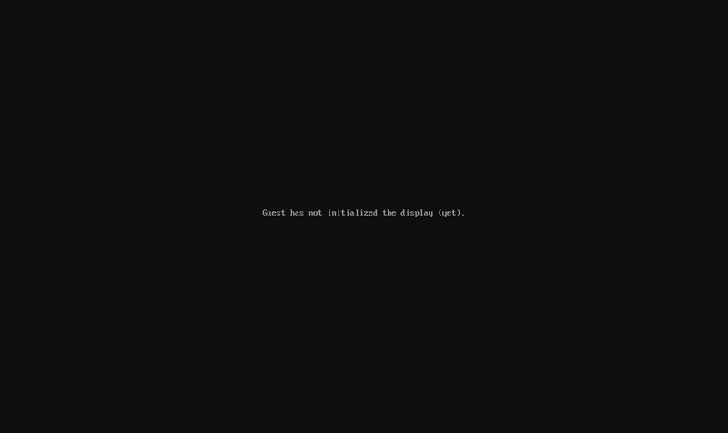

# ferriboot



A UEFI bootloader for Linux written in Rust. It loads the kernel and initramfs from the EFI System Partition and starts Linux through the x86 boot protocol (not the EFI stub). It can also chainload Unified Kernel Images (UKI), Windows Boot Manager and other EFI applications. It comes with a small boot menu.

`ferriboot` (the CLI) installs the bootloader, registers it in the firmware, generates the config and keeps it up to date after kernel updates.

## How it boots

- **Linux kernel + initramfs** (`protocol: linux`): ferriboot parses the bzImage setup header, loads the kernel and initramfs, builds `boot_params` (e820 memory map, framebuffer, EFI system table, ACPI RSDP) and jumps into the kernel after `ExitBootServices`.
- **UKI, Windows and other EFI applications** (`protocol: efi`): ferriboot loads the image with the firmware's `LoadImage` and starts it with `StartImage`. A UKI brings its own kernel, initramfs and command line.
- **Boot Loader Interface:** ferriboot sets `LoaderInfo`, `LoaderEntrySelected` and the `LoaderTime*` variables, so `bootctl status` shows it and `systemd-analyze` reports the loader time.

`ferriboot mkconfig` builds the menu from:

- UKIs in `EFI/Linux/*.efi` on the ESP (listed first)
- kernels (`vmlinuz-*`) on the ESP and in `/boot`
- Windows Boot Manager at `EFI/Microsoft/Boot/bootmgfw.efi` (listed last)


## Compatibility

| System             | Environment   | Boot | Kernel update hook                     |
|--------------------|---------------|------|----------------------------------------|
| Arch Linux         | Real hardware | ✅   | ✅ pacman hook                          |
| Arch Linux (UKI)   | Real hardware | ✅   | ⚠️ pacman hook                          |
| Fedora 44          | QEMU / OVMF   | ✅   | ✅ kernel-install plugin                |
| Ubuntu             | QEMU / OVMF   | ✅   | ⚠️ `/etc/kernel/postinst.d`             |
| Debian             | —             | ⚠️   | ⚠️ `/etc/kernel/postinst.d`             |
| Windows (dual boot)| —             | ⚠️   | —                                      |

✅ tested · ⚠️ implemented but not yet tested

## Limitations

- x86_64 UEFI systems only
- Secure Boot is not supported
- Only the ESP ferriboot is started from is searched: Windows and other EFI applications on another disk are not detected
- Kernels without an initramfs are skipped by `mkconfig`
- NixOS is not supported (it would need a dedicated NixOS module)
- No measured boot: the kernel, initramfs and command line are not measured into the TPM, so TPM-sealed secrets bound to those PCRs (for example LUKS unlock with `systemd-cryptenroll --tpm2-pcrs=9`) will not work
- The TPM event log is not passed to the kernel (normally the EFI stub does this), so `/sys/kernel/security/tpm0/binary_bios_measurements` may be missing

> **Windows with BitLocker:** starting Windows through another bootloader can change TPM measurements, and Windows may ask for the BitLocker recovery key. Make sure you have it before trying.

## Benchmark

### Real hardware

Laptop (Intel i5-9300H, NVMe, TPM 2.0), Arch Linux, kernel 7.2, ~100 MB initramfs.
Same kernel, initramfs and command line for every loader, menu timeout 0, 10 boots each.
Loader time is the `(loader)` value from `systemd-analyze` (median):

| Loader       | Loader time |
|--------------|-------------|
| ferriboot    | 294 ms      |
| systemd-boot | 1.44 s      |
| GRUB         | 1.63 s      |

Each loader reports its own start and handoff times through the
[Boot Loader Interface](https://systemd.io/BOOT_LOADER_INTERFACE/), so the
measurement points are similar but not identical.

### Why the gap: QEMU, one factor at a time

`bench/bench.sh`, QEMU/KVM + OVMF, time from VM start to the first kernel log line (median of 10):

| Loader       | Base   | + software TPM | Slow disk (2000 IOPS) |
|--------------|--------|----------------|-----------------------|
| ferriboot    | 1.43 s | 2.68 s         | 1.45 s                |
| systemd-boot | 1.56 s | 4.07 s         | 1.58 s                |
| GRUB         | 1.59 s | 4.40 s         | 3.10 s                |

- Without a TPM, all three are within ~10%.
- A TPM slows every loader down (firmware work), but systemd-boot and GRUB lose
  an extra ~1.3–1.6 s. This is consistent with measured boot: they have the
  kernel and initramfs hashed into the TPM, and ferriboot does not.
- A slow disk only affects GRUB, which reads FAT with its own driver.

**ferriboot is faster mainly because it does less.** It skips measured boot,
which costs over a second on hardware with a TPM. See Limitations for what you
give up.

## Building

```
rustup target add x86_64-unknown-uefi
cargo build --release -p bootloader --target x86_64-unknown-uefi
cargo build --release -p ferriboot-cli --target x86_64-unknown-linux-gnu
```

## Installing

```
sudo ./target/x86_64-unknown-linux-gnu/release/ferriboot install \
    --efi target/x86_64-unknown-uefi/release/bootloader.efi
```

This copies the bootloader to `EFI/ferriboot/` on the ESP, writes `EFI/ferriboot/ferriboot.conf`, adds a firmware boot entry, installs `/usr/local/bin/ferriboot` and a kernel update hook (pacman, kernel-install or `/etc/kernel/postinst.d`).

Keep another bootloader installed until you have checked that ferriboot boots your system.

## Installing on Arch Linux

Add the ferriboot repository and its signing key once:

```
curl -L -o /tmp/ferriboot.asc https://github.com/quaslir/ferriboot/releases/download/repo/ferriboot.asc
sudo pacman-key --add /tmp/ferriboot.asc
sudo pacman-key --lsign-key 0F932E1F8911EEBDAE9E2680EA7C543494A99C91
```

Append to `/etc/pacman.conf`:

```
[ferriboot]
SigLevel = Required DatabaseRequired
Server = https://github.com/quaslir/ferriboot/releases/download/repo
```

Then:

```
sudo pacman -Syu ferriboot
sudo ferriboot install
```

Alternatively, build the package yourself from `packaging/arch` with `makepkg -si`.

## Usage

```
sudo ferriboot mkconfig            # regenerate the config
sudo ferriboot mkconfig --dry-run  # show what would change
sudo ferriboot uninstall           # remove everything
```

## Configuration

The config lives at `EFI/ferriboot/ferriboot.conf` on the ESP and is generated by `ferriboot mkconfig`. Paths are relative to the ESP and use backslashes.

```
timeout: 3
default: 1

/Arch Linux (UKI: arch-linux)
protocol: efi
path: \EFI\Linux\arch-linux.efi

/Arch Linux (linux)
protocol: linux
kernel: \vmlinuz-linux
initrd: \initramfs-linux.img
cmdline: root=UUID=... rw

/Windows Boot Manager
protocol: efi
path: \EFI\Microsoft\Boot\bootmgfw.efi
```

`default` counts from 1. Manual edits are overwritten the next time `mkconfig` runs.

## Roadmap

- [x] Boot Linux via the x86 boot protocol
- [x] Unified Kernel Images (UKI) via EFI chainloading
- [x] Windows Boot Manager entry (not yet tested on real Windows)
- [x] Boot log on the ESP and Boot Loader Interface (`systemd-analyze` support)
- [ ] Persistent settings (`/etc/ferriboot.conf`: timeout, default entry)
- [ ] Full-boot benchmark (VM start → multi-user.target)
- [ ] Secure Boot

## License

MIT
